# End-to-end NYC Taxi Trip Data Pipeline | Microsoft Fabric

An end-to-end data engineering project built using Microsoft Fabric to automate the ingestion, transformation, and presentation of NYC Yellow Taxi trip data.

## Project Overview

This project demonstrates an end-to-end data engineering solution using Microsoft Fabric. It processes monthly NYC Yellow Taxi trip datasets from January 2024 through June 2024, transforming raw trip records into enriched, analytics-ready data stored in a Fabric Warehouse.

The solution uses Microsoft Fabric Data Factory, Dataflow Gen2, and Fabric Warehouse to build a reusable and automated data processing workflow.

## Project Objectives

- Automate the ingestion of monthly NYC Yellow Taxi Parquet files.
- Implement dynamic monthly data loading without manually changing pipeline configurations.
- Clean and enrich taxi trip data using reference datasets.
- Transform raw data into structured, analytics-ready records.
- Store processed data in a Fabric Warehouse.
- Maintain pipeline execution metadata for monitoring and processing checkpoints.
- Orchestrate staging and presentation pipelines through a master pipeline.

## Technology Stack

| Technology | Purpose |
|---|---|
| Microsoft Fabric | Unified data engineering platform |
| Data Factory | Pipeline development and orchestration |
| OneLake | Data storage |
| Dataflow Gen2 | Data cleaning and transformation |
| Fabric Warehouse | Structured data storage |
| T-SQL | SQL transformations and stored procedures |
| GitHub | Source control and project documentation |


---

## Solution Architecture

The project follows a layered data engineering architecture in Microsoft Fabric, consisting of data ingestion, transformation, and presentation layers, coordinated through a master orchestration pipeline.


### Architecture Components

1. **Ingestion Layer:** Loads monthly NYC Yellow Taxi Parquet files from OneLake into the Warehouse staging table.
2. **Transformation Layer:** Uses Dataflow Gen2 to clean trip data and enrich pickup and drop-off locations with borough and zone information.
3. **Presentation Layer:** Stores the cleaned and enriched data in an analytics-ready Warehouse table.
4. **Orchestration Layer:** Coordinates staging and presentation pipelines using sequential execution and success dependencies, with scheduled and event-based triggers.


---

## Data Source & Dataset

The project uses NYC Yellow Taxi Trip Records published by the New York City Taxi and Limousine Commission (TLC).

**Dataset Details**

| Attribute | Details |
|---|---|
| Dataset | NYC Yellow Taxi Trip Records |
| Data Period | January 2024 – June 2024 |
| File Format | Parquet |
| Data Type | Monthly trip-level records |
| Storage | Microsoft Fabric OneLake |
| Reference Data | Taxi Zone Lookup Dataset |

**Source:** [NYC TLC Trip Record Data](https://www.nyc.gov/site/tlc/about/tlc-trip-record-data.page)

**Lakehouse File Structure**

```text
NYCProjectLakehouse/
└── Files/
    ├── nyctaxi_yellow/
    │   ├── yellow_tripdata_2024-01.parquet
    │   ├── yellow_tripdata_2024-02.parquet
    │   ├── yellow_tripdata_2024-03.parquet
    │   ├── yellow_tripdata_2024-04.parquet
    │   ├── yellow_tripdata_2024-05.parquet
    │   └── yellow_tripdata_2024-06.parquet
    │
    └── nyctaxi_zone_lookup/
```

---

## Data Ingestion Layer

The ingestion layer uses Microsoft Fabric Data Factory to load monthly Yellow Taxi Parquet files from OneLake into the Warehouse staging table.

### Initial Staging Run

The initial run loads the January 2024 dataset into the staging table and establishes the processing checkpoint through metadata logging.

### Dynamic Staging Run

Subsequent runs dynamically identify the next processing period using the latest processed pickup datetime stored in the metadata processing log.

The pipeline uses parameterized date values to load the required monthly dataset without manually changing the pipeline configuration.

**Destination Table:** `stg.nyctaxi_yellow`

**Key Capabilities**
- Dynamic monthly file selection.
- Parameterized date-based ingestion.
- Pre-copy data cleanup.
- Pipeline execution metadata logging.

### Ingestion Pipeline Implementation

**Initial (Staging) Run**
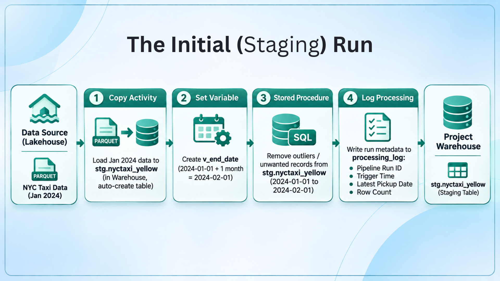
**Dynamic (Automated) Run**
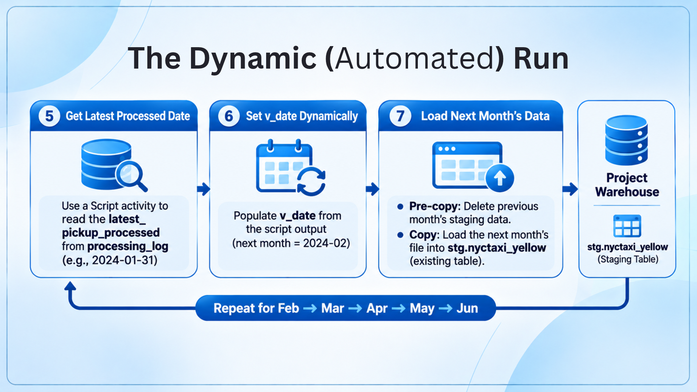

## Data Transformation Layer

The transformation layer uses **Dataflow Gen2** to clean, structure, and enrich the staging data before loading it into the presentation layer.

### Transformation Workflow

1. **Source Data:** Read trip records from `stg.nyctaxi_yellow` and reference data from `nyctaxi_zone_lookup`.

2. **Data Preparation:** Select and transform the required columns, standardizing the data structure for downstream processing.

3. **Pickup Location Enrichment:** Merge the trip data with the taxi zone lookup using the pickup location ID to retrieve the corresponding pickup zone and borough.

4. **Drop-off Location Enrichment:** Perform another merge using the drop-off location ID to retrieve the corresponding drop-off zone and borough.

5. **Final Transformation:** Expand the lookup columns and prepare the cleaned, enriched dataset for loading.

### Enriched Output

The resulting dataset contains:

| Column | Description |
|---|---|
| `pu_borough` | Pickup borough |
| `pu_zone` | Pickup zone |
| `do_borough` | Drop-off borough |
| `do_zone` | Drop-off zone |

**Destination Table:** `dbo.nyctaxi_yellow`

### Transformation Implementation

**Transformation Logic - Cleansing & Pickup and Drop-off Enrichment**
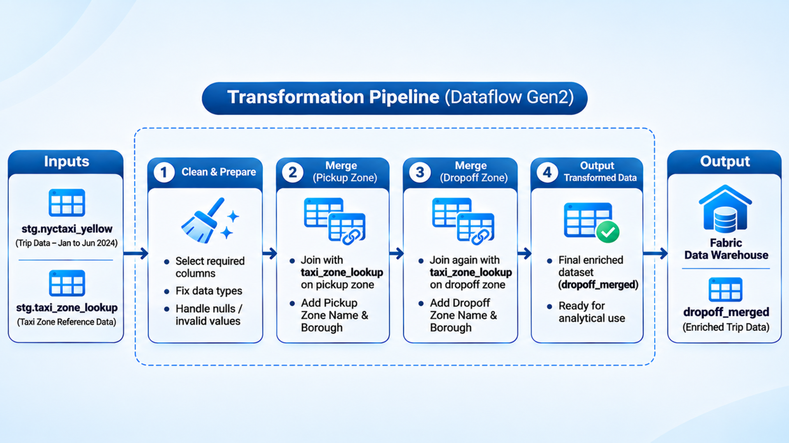

**Full Dataflow Implementation**
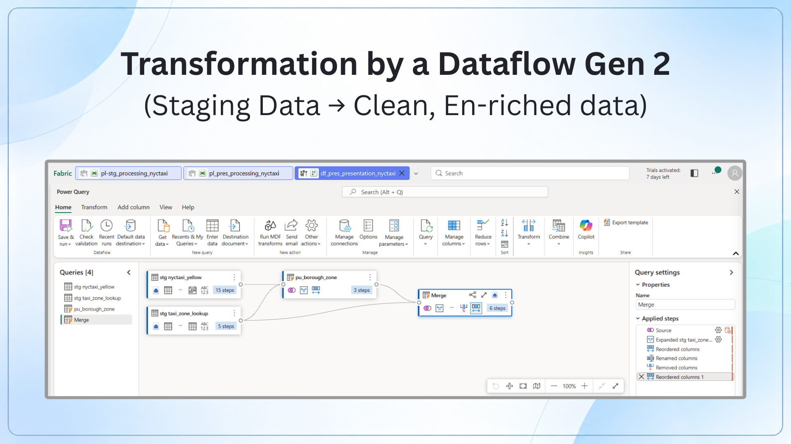

## Presentation Layer

The presentation layer stores the cleaned and enriched taxi trip data in the Microsoft Fabric Warehouse, making it ready for downstream analytical consumption.

### Presentation Pipeline

The pipeline `pl_pres_processing_nyctaxi` executes the following activities sequentially:

1. **Run Dataflow Gen2:** Executes the transformation dataflow to clean and enrich the staging data.
2. **Load Presentation Table:** Stores the transformed data in the `dbo.nyctaxi_yellow` presentation table.
3. **Log Execution Metadata:** Upon successful dataflow execution and data loading, executes a stored procedure to record pipeline run details in the metadata processing log.

### Metadata Processing Log

The project maintains a centralized processing log to capture execution details for both staging and presentation runs.

The `metadata.processing_log` table stores:

| Column | Description |
|---|---|
| `pipeline_run_id` | Unique pipeline execution ID |
| `table_processed` | Name of the processed table |
| `rows_processed` | Number of rows processed |
| `latest_processed_pickup` | Latest pickup datetime processed |
| `processed_datetime` | Date and time of processing |

### Presentation Implementation

**Presentation Pipeline – Dataflow and Metadata Logging**
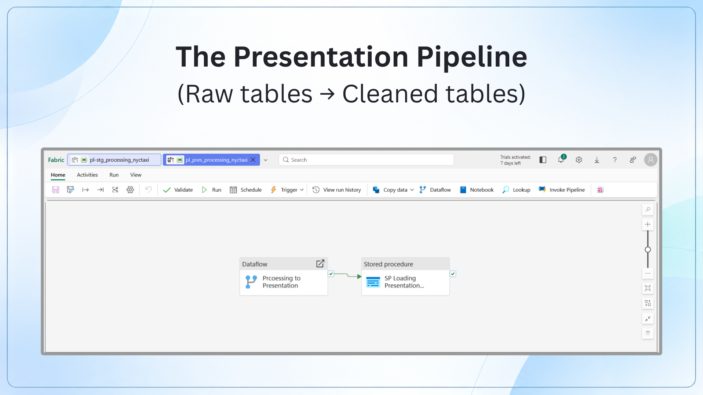

**Presentation Warehouse Table**
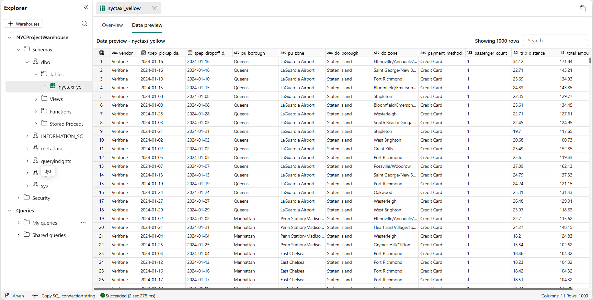

**Metadata Processing Log**
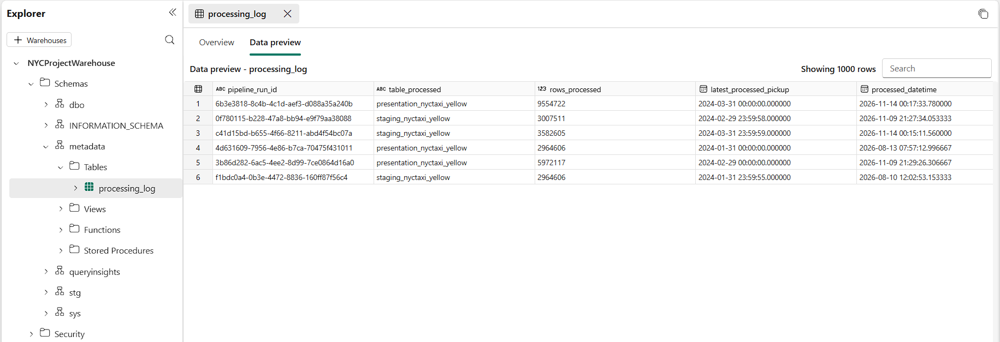

---

## Orchestration Layer

The orchestration layer coordinates the staging and presentation pipelines through a master pipeline, ensuring that data ingestion and transformation execute in the correct sequence.

### Master Orchestration Pipeline

The master pipeline manages the end-to-end processing workflow through two sequential pipeline executions:

1. **Staging Pipeline:** Executes the staging pipeline to ingest monthly Parquet data into the Warehouse staging table `stg.nyctaxi_yellow`.

2. **Presentation Pipeline:** Executes only after the staging pipeline succeeds. It transforms the staged data and loads the cleaned, enriched records into `dbo.nyctaxi_yellow`.

This dependency ensures that presentation processing starts only after successful staging execution.

### Pipeline Execution Triggers

The orchestration pipeline can support two execution approaches:

- **Scheduled Trigger:** Runs the master pipeline on a predefined schedule aligned with the arrival of monthly datasets.
- **OneLake Event Trigger:** Initiates the master pipeline when a new dataset file is added to the configured Lakehouse location.

For more autonomous operation, a **OneLake Event Trigger** is implemented which initiate the master pipeline when a new monthly dataset is added to the configured Lakehouse location `Files/nyctaxi_yellow`.

### End-to-End Workflow

The complete execution sequence is:

`New Monthly File → Master Pipeline → Staging Pipeline → Presentation Pipeline → Warehouse`

### Orchestration Implementation

**Master Orchestration Pipeline**

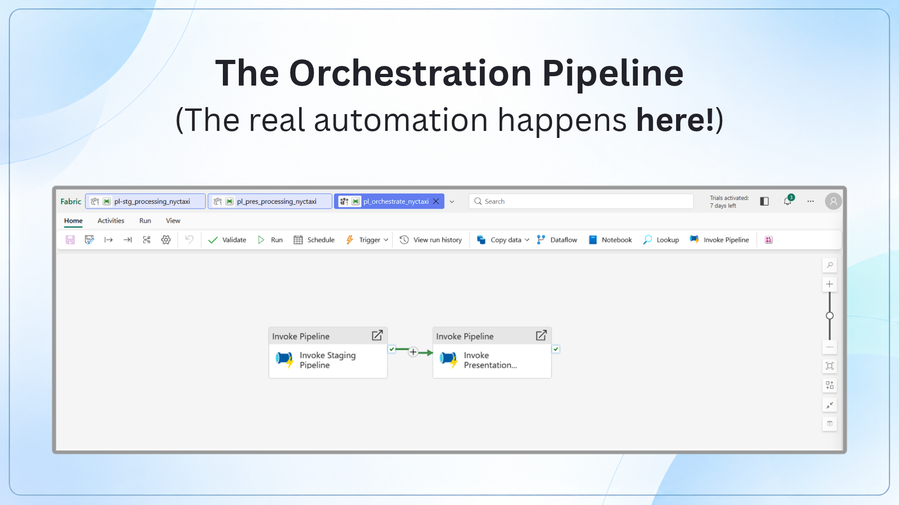

**OneLake Event Trigger Configuration**

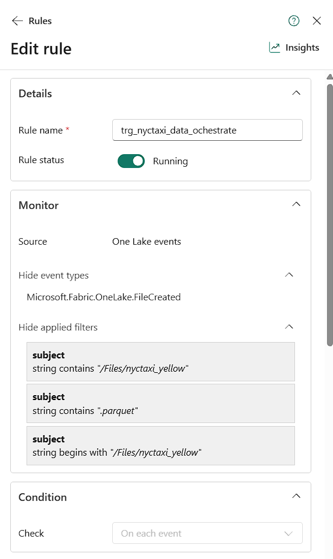
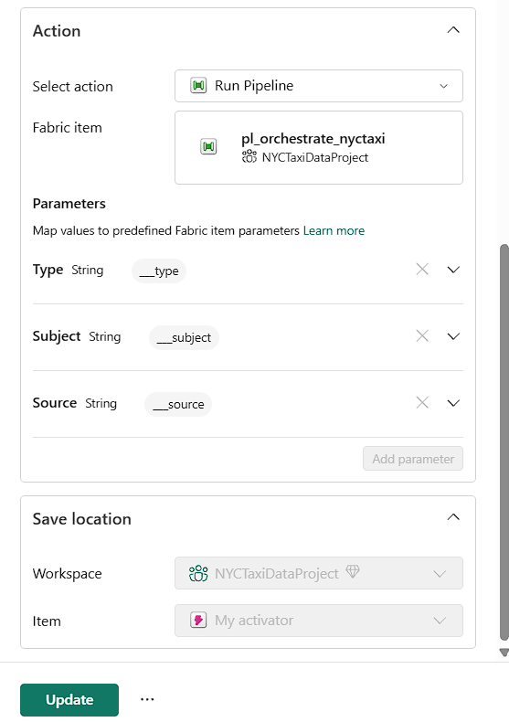

**Pipeline Execution History**

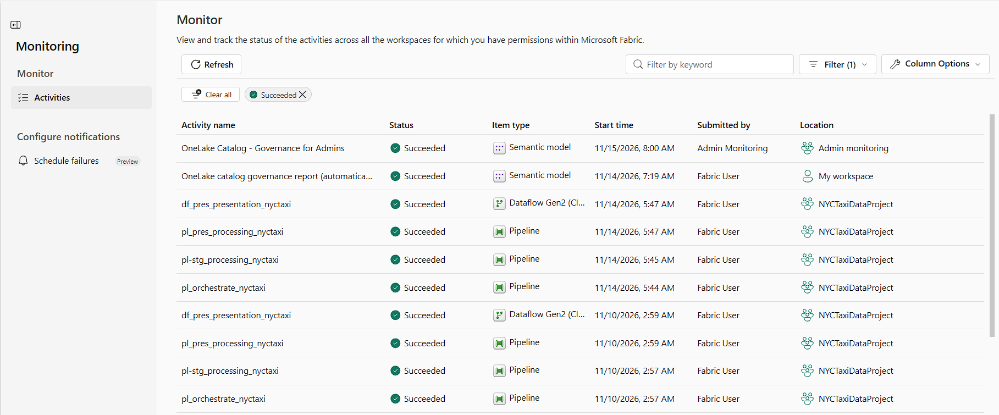


## SQL Implementation

T-SQL is used to manage staging data, create Warehouse tables, and maintain pipeline execution metadata.

### Table Creation

| SQL Script | Purpose |
|---|---|
| [create-presentation-table]() | Creates the presentation table |
| [create-processing-log-table]() | Creates the metadata processing log |

### Stored Procedures

| Stored Procedure | Purpose |
|---|---|
| [data-cleaning-staging](sql/data-cleaning/data_cleaning_staging.sql) | Removes records outside the processing date range in the staging table |
| [insert-staging-metadata]() | Inserts staging execution metadata |
| [insert-presentation-metadata]() | Inserts presentation execution metadata |

### Pre-copy Script

[pre-copy-getLatestProcessedPickup]()

Retrieves the latest processed pickup datetime from the metadata processing log to support dynamic monthly ingestion.
