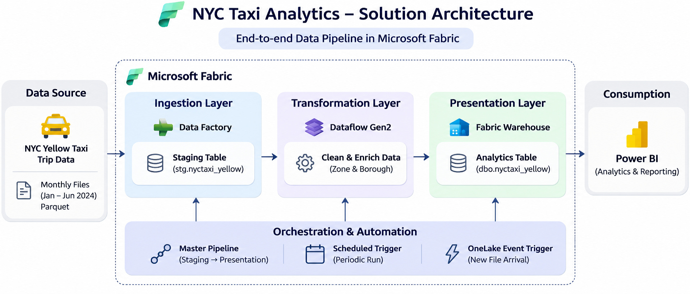

# End-to-end NYC Taxi Trip Data Pipeline | Microsoft Fabric

An end-to-end data engineering project built using Microsoft Fabric to automate the ingestion, transformation, and presentation of NYC Yellow Taxi trip data.

## Project Overview

This project demonstrates an end-to-end data engineering solution using Microsoft Fabric. It processes monthly NYC Yellow Taxi trip datasets from January 2024 through June 2024, transforming raw trip records into enriched, analytics-ready data stored in a Fabric Warehouse.

The solution uses Microsoft Fabric Data Factory, Dataflow Gen2, and Fabric Warehouse to build a reusable and automated data processing workflow.

## Project Objectives

- Automate the ingestion of monthly NYC Yellow Taxi Parquet files.
- Implement dynamic monthly data loading without manually changing pipeline configurations.
- Clean and enrich taxi trip data using reference datasets.
- Transform raw data into structured, analytics-ready records.
- Store processed data in a Fabric Warehouse.
- Maintain pipeline execution metadata for monitoring and processing checkpoints.
- Orchestrate staging and presentation pipelines through a master pipeline.

## Technology Stack

| Technology | Purpose |
|---|---|
| Microsoft Fabric | Unified data engineering platform |
| Data Factory | Pipeline development and orchestration |
| OneLake | Data storage |
| Dataflow Gen2 | Data cleaning and transformation |
| Fabric Warehouse | Structured data storage |
| T-SQL | SQL transformations and stored procedures |
| GitHub | Source control and project documentation |

---

## Solution Architecture

The project follows a layered data engineering architecture in Microsoft Fabric, consisting of data ingestion, transformation, and presentation layers, coordinated through a master orchestration pipeline.

### Architecture Components

1. **Ingestion Layer:** Loads monthly NYC Yellow Taxi Parquet files from OneLake into the Warehouse staging table.
2. **Transformation Layer:** Uses Dataflow Gen2 to clean trip data and enrich pickup and drop-off locations with borough and zone information.
3. **Presentation Layer:** Stores the cleaned and enriched data in an analytics-ready Warehouse table.
4. **Orchestration Layer:** Coordinates staging and presentation pipelines using sequential execution and success dependencies, with scheduled and event-based triggers.
